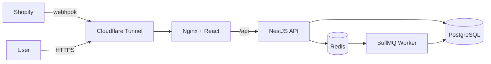
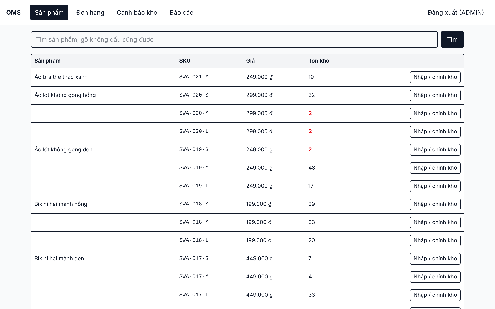
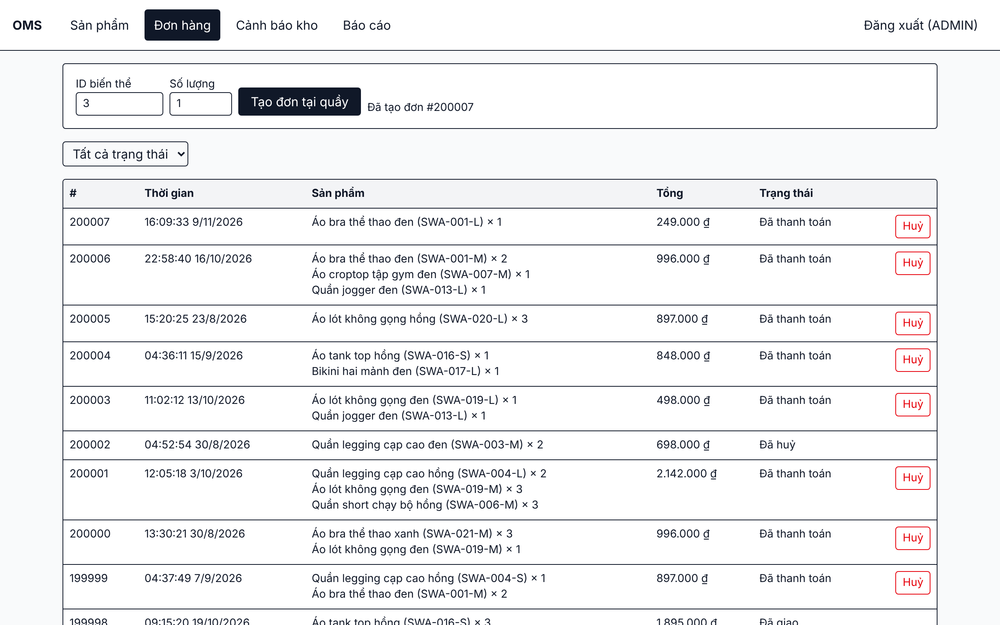
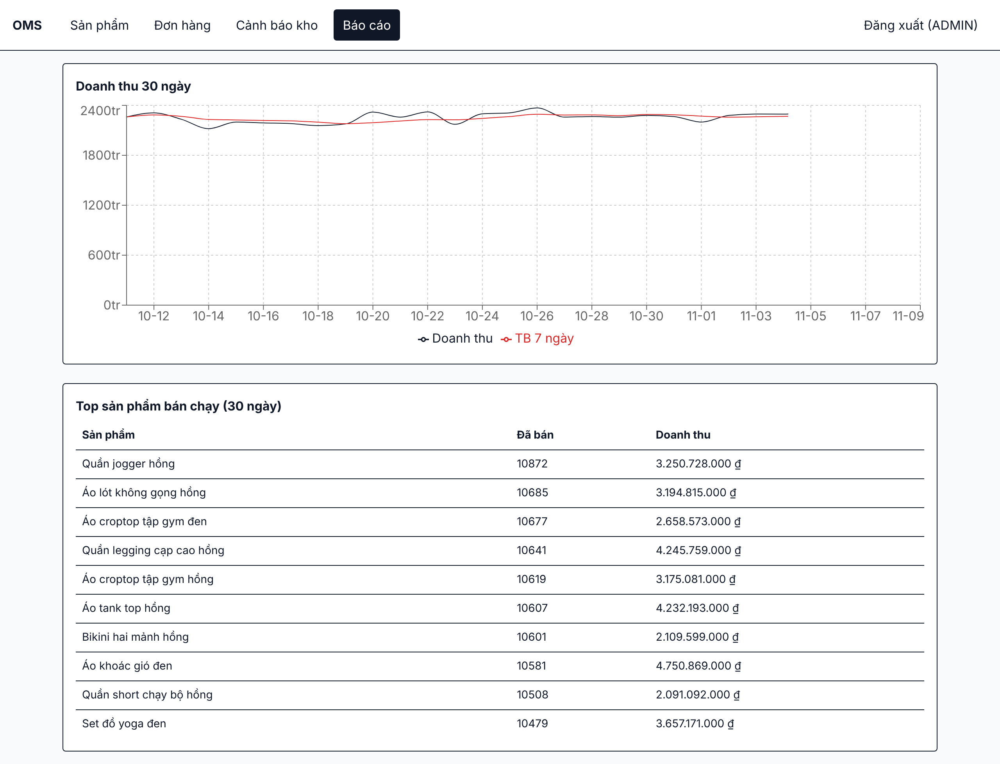

# OMS — Order & Inventory Management System


Backend-focused system that manages products, stock and orders for a real women's activewear
store (Shoping with Angel). Orders placed on Shopify sync in real time through webhooks.

**Demo video:** _coming soon_  •  **API docs:** `/api/docs` (Swagger)

## Tech stack
Node.js 24 · TypeScript · NestJS 12 · PostgreSQL 17 · Prisma 7 · Redis · BullMQ · React · Docker · GitHub Actions · Cloudflare Tunnel

## Architecture


```
apps/api    NestJS backend (API + separate BullMQ worker process)
apps/web    React admin (Vite, TanStack Query, Tailwind, Recharts)
load/       k6 load-test scripts
scripts/    SQL data generator, backup script
docs/       measurements and screenshots
```

## Key technical decisions

### 1. Preventing overselling under concurrency
Stock is checked and decremented in a single conditional `UPDATE ... WHERE available >= qty`
inside a transaction. Rows are locked in a consistent order (sorted by variant id) to avoid
deadlocks, and a `CHECK (available >= 0)` constraint acts as a last line of defense.
**Verified:** 100 concurrent orders for 1 remaining item → exactly 1 success, 99 × 409, stock = 0
(also covered by an e2e test that runs in CI).

| Approach | Pros | Cons |
|---|---|---|
| Conditional UPDATE (used) | 1 round trip, simple | Only for simple conditions |
| SELECT ... FOR UPDATE | Arbitrary checks in code | 2 round trips, longer locks |
| Optimistic (version column) | No blocking | Retry storms under high contention |

Cancelling an order locks the order row with `SELECT ... FOR UPDATE`, so two concurrent cancels
cannot return stock twice.

### 2. Reliable Shopify webhooks
HMAC-SHA256 signature verification on the raw body (constant-time compare), idempotency via the
webhook ID as a primary key plus a unique `shopifyOrderId`, async processing in BullMQ with
exponential-backoff retries. When Shopify sold more than OMS has, the order is still recorded,
stock is clamped to 0 and an `ADJUST` movement flags the mismatch.

### 3. Rate limiting
Token bucket implemented as an atomic Redis Lua script (20 burst, 5 req/s per user; per IP for login).

### 4. Search & reporting in SQL
Accent-insensitive Vietnamese full-text search (`unaccent` + generated `tsvector` + GIN index):
`ao the thao` finds "Áo bra thể thao". Revenue report with `generate_series`, Vietnam time zone
bucketing and a 7-day moving average window function. Nightly "bought together" pairs via a
self-join on order items; morning low-stock alerts (reorder point) sent to Telegram.

## Performance
Measured with k6, 50 virtual users, 30 s, on a 4 vCPU / 16 GB Linux VM, API called directly
(rate limiting disabled for the test). Details in [docs/measurements.md](docs/measurements.md).

| Scenario | p95 | req/s | Errors |
|---|---|---|---|
| Product detail, no cache | 67.1 ms | ~940 | 0% |
| Product detail, Redis cache | 28.0 ms | ~2,450 | 0% |
| Product list (20 items) | 108.8 ms | ~560 | 0% |

Index impact (`EXPLAIN ANALYZE`, 200k orders / 400k order items):
order items by order id **17.5 ms → 0.04 ms** (Seq Scan → Index Scan).
The 7-day top-products report stays on a sequential scan (54.6 ms → 58.5 ms): the planner
correctly prefers it when a large share of rows is read.

## Screenshots
| Products | Orders | Reports |
|---|---|---|
|  |  |  |

## Run locally
```bash
docker compose up -d
cd apps/api && npm ci && npx prisma migrate dev && npx prisma generate && npx prisma db seed && npm run start:dev
cd apps/api && npm run start:worker:dev   # second terminal: BullMQ worker
cd apps/web && npm ci && npm run dev      # third terminal: http://localhost:5173
```
`apps/api/.env` needs `DATABASE_URL`, `REDIS_URL`, `JWT_SECRET` (see `.env.example`).
Default accounts: `admin@oms.local / Admin@123`, `staff@oms.local / Staff@123`.

New migrations: always `npx prisma migrate dev --create-only`, then remove any
`DROP INDEX "product_search_idx"` / `ALTER COLUMN "search"` lines before applying
(Prisma does not model the generated search column's GIN index).

## Testing
`npm test` (unit) · `npm run test:e2e` (real PostgreSQL + Redis, includes the
100-concurrent-orders test, rollback, roles, webhooks) · `npm run test:e2e:cov`.
CI runs lint, build, unit and e2e tests on every pull request.

## Deployment
Push to `main` → GitHub Actions builds the `oms-api` and `oms-web` images, pushes them to GHCR,
then SSHes into the VPS to pull, run `prisma migrate deploy` and restart (`docker-compose.prod.yml`).
The VPS exposes no web ports; traffic arrives through Cloudflare Tunnel. Daily `pg_dump` backups
via `scripts/backup.sh`.

## Future improvements
Refresh tokens in httpOnly cookies · partial-word search with `pg_trgm` · multi-warehouse stock ·
metrics and tracing.
